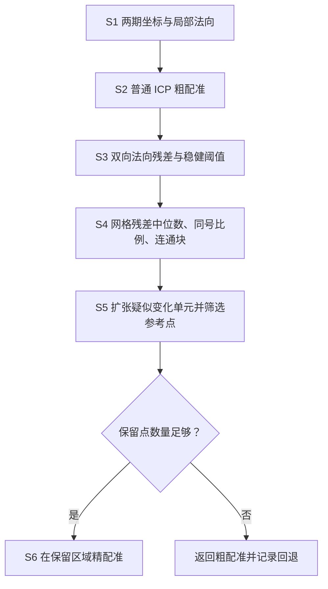

# 自动稳定区域筛选：初版实现与对照

本阶段实现只读取两期坐标的候选筛选机制，同时保留成熟对照与消融。它是开发初版，不是已经证实有新颖性的算法。

## 算法是否读取答案

算法在两个独立 worker 中先执行完毕，然后评价脚本才读取真值。worker 的审计钩子禁止读取数据集内除指定 inputs.npz 外的任何文件；每组 input_access_audit.json 保存访问记录。候选算法未获得堆积圆心、半径、高度、生成噪声、正确位姿或标签。真值掩膜仅用于拟合后评价识别精度。

候选参数见 frozen_config.json，运行前固定并记录SHA256；尺度由参考点云中位最近邻间距估计。两组采用同一参数配置。当前两组是已使用过的开发数据，不属于独立留出的测试集。

## 候选流程



法向通过24邻点PCA计算，朝+Z统一方向，适用于当前地形高程曲面假设。粗配准上限50步；候选与两个消融的精配准上限100步，总更新次数上限150。最终拟合仍为正确 Kabsch 的点到点 ICP，法向只用于筛选证据。

双向匹配的法向残差减去全局中位数，以1.4826×MAD估计尺度，尺度下界为点间距的0.05倍；阈值是该尺度的3倍。网格边长取点间距的6倍。单元至少12个双向配对观测，中位残差超阈值且同号超过半阈值的比例至少0.65，才标为疑似变化。保留同号26邻接中至少3个单元组成的连通块，扩张一层网格，再从两期剔除对应区域及距离过大的不可靠匹配。若任一期保留不足50%或30点则回退。双向观测并非独立样本，不将这些比例解释为统计置信度。

## 对照与消融的实际实现

| 方法 | 实际实现 |
| --- | --- |
| 普通 ICP | 全部点，最多150次更新 |
| 固定90%截尾 ICP | 每次保留欧氏最近邻残差最小的90%点对；是固定比例对照，不是完整的自适应重叠率 TrICP 复现 |
| Huber 加权 ICP | 以欧氏点对距离的MAD、点间距下界和1.345倍系数构造权重，用加权Kabsch迭代；不冒充Open3D点到面稳健ICP实现 |
| 法向空间采样 ICP | +Z半球按方位和余弦分层，每期至多6000点，再普通ICP；是法向采样思想的明确实现，不是原论文全套设置 |
| 逐点残差筛选 | 同样粗配准、法向残差和阈值，逐点筛选，不使用区域连通与扩张 |
| 区域筛选、不扩张 | 与候选相同，关闭网格扩张，检查边界扩张作用 |
| 区域一致性候选 | 完整S1—S6流程 |

所有方法从单位矩阵开始，最多150次ICP更新；有的包含特征预处理，不能把迭代次数相同理解为运行成本相同。耗时包括各自需要的法向/筛选成本，公共缓存时间也对相关方法计费。

## 实际结果

| 组别 | 方法 | 平移误差/mm | 旋转误差/度 | 独立稳定区位姿残差/mm | 保留t2点数 |
| --- | --- | ---: | ---: | ---: | ---: |
| 纯配准 | 普通 ICP | 1.4559 | 0.003866 | 1.7561 | 13155 |
| 纯配准 | 固定90%截尾 ICP | 0.0446 | 0.000287 | 0.0868 | 13155 |
| 纯配准 | Huber 加权 ICP | 0.1079 | 0.000452 | 0.1507 | 13155 |
| 纯配准 | 法向空间采样 ICP | 6.3568 | 0.012000 | 7.1260 | 6000 |
| 纯配准 | 逐点法向残差筛选（消融） | 0.4762 | 0.000765 | 0.5086 | 12280 |
| 纯配准 | 区域筛选、不扩张（消融） | 1.4559 | 0.003866 | 1.7561 | 13155 |
| 纯配准 | 区域一致性筛选候选方法 | 1.4559 | 0.003866 | 1.7561 | 13155 |
| 局部堆积 | 普通 ICP | 7.2360 | 0.026320 | 9.0700 | 13155 |
| 局部堆积 | 固定90%截尾 ICP | 2.5396 | 0.008943 | 3.1500 | 13155 |
| 局部堆积 | Huber 加权 ICP | 0.6507 | 0.002763 | 0.8774 | 13155 |
| 局部堆积 | 法向空间采样 ICP | 5.6258 | 0.032551 | 10.6710 | 6000 |
| 局部堆积 | 逐点法向残差筛选（消融） | 0.9383 | 0.001202 | 0.9751 | 11825 |
| 局部堆积 | 区域筛选、不扩张（消融） | 1.6153 | 0.006141 | 2.1384 | 12705 |
| 局部堆积 | 区域一致性筛选候选方法 | 1.4150 | 0.004112 | 1.7755 | 12256 |


局部堆积组中，候选相对普通ICP的平移误差变化（正数为改善）为 80.44%。成熟对照中平移误差最低的是 Huber 加权 ICP（0.6507 mm）；候选没有优于这个对照。所有方法及两个消融均保留，没有按测试真值挑选参数后隐藏失败设置。

## 自动筛选评价

只对三个明确输出稳定区域掩膜的方法计算变化区识别指标；截尾、加权和法向采样的保留点不当作变化检测标签。变化点真值包含隆起边缘极小正高差，识别率不能代替位姿评价。

| 方法（局部堆积组） | 排除点中的真实变化比例 | 真实变化点排除率 | 未变化点误排比例 |
| --- | ---: | ---: | ---: |
| 逐点法向残差筛选（消融） | 37.67% | 67.70% | 6.68% |
| 区域筛选、不扩张（消融） | 100.00% | 60.81% | 0.00% |
| 区域一致性筛选候选方法 | 81.54% | 99.05% | 1.34% |

## 已有工作与区别边界

详见同目录已有方法核对.md。残差剔除、MAD、法向空间采样、区域稳定性和稳健加权均有成熟来源。本初版组合双向法向残差、单元同号一致性、连通块和扩张，属于候选工程流程；尚未证明它相对最接近方法有独立技术增量。不能据此直接宣称专利新颖性。

本次未把此前异常的py4dgeo 1.2.0稳定区ICP重新包装成成功结果，也没有完整复现Yang/Schwieger的超体素方法。该已有方法对照仍应单列为后续待核查项。

## 文件与复现

- configs/automatic_stable_v1.json：工程参数；frozen_config.json：本次冻结参数。
- scripts/automatic_stable_icp.py：仅坐标算法及受审计worker；scripts/run_automatic_stable_experiment.py：运行和独立评价。
- 每组每方法的 after_overlay.ply：参考t1蓝色、变换后的完整t2橙色；变化点没有从最终输出删除。
- patch_candidate/reference_selection.ply：自动选中的点绿色、排除点红色；moving_selection_auto_aligned.ply 是应用估计变换后的t2筛选图。
- algorithm_result.npz、algorithm_info.json、iterations.csv：算法原始输出；evaluation.json：事后真值评价。
- results.csv/json、findings.json、validation.json、protocol.json：完整结果、解释、验证和协议。
- input_only_evidence.npz、patch_statistics.csv、diagnostics.json：粗配准残差、网格统计及估计尺度。
- CloudCompare文件沿用terrain_benchmark的局部米制坐标，原点见metadata.json。

```powershell
& .\.venv\Scripts\python.exe scripts\run_automatic_stable_experiment.py --dataset terrain_benchmark_v1 --output automatic_stable_v1
```

当前仅一个地形、一个噪声种子和一个堆积配置。冻结此初版后，后续应使用独立噪声/密度/变化配置测试，并实现体积估计；不要根据本次真值反复调整阈值再报告为独立测试。

验证：全部通过。